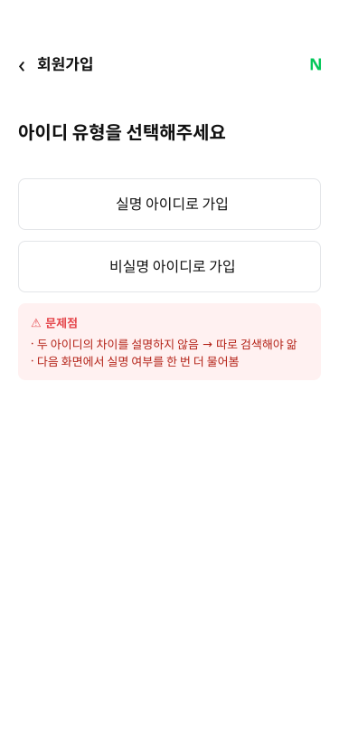
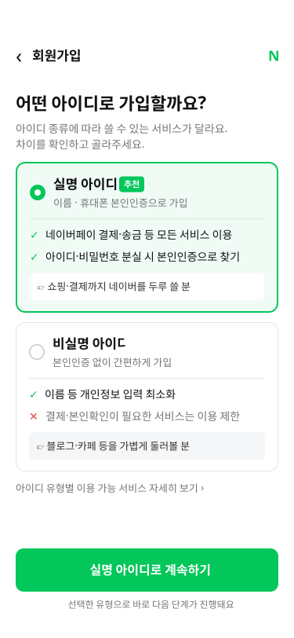
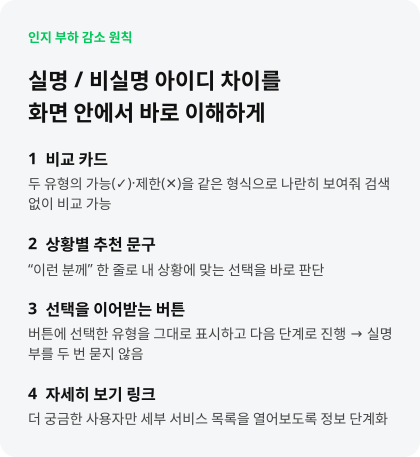

# UX-

## 회원가입 아이디 유형 선택 UX 개선

> 실명 / 비실명 아이디의 차이를 화면 안에서 바로 이해하게 만들기

기존 화면을 재구성한 Before와 개선안을 비교한 UX 디자인 사례입니다. 사용자가 별도 검색 없이 두 유형을 비교하고, 자신의 이용 목적에 맞는 선택을 할 수 있도록 **인지 부하 감소**에 초점을 맞췄습니다.

### Before / After

| Before — 기존 화면(재구성) | After — 개선 화면 |
| :---: | :---: |
|  |  |

### 기존 화면의 문제

- 실명 / 비실명 아이디의 차이를 화면 안에서 설명하지 않아 사용자가 따로 검색해야 합니다.
- 다음 화면에서 실명 여부를 한 번 더 묻는 구조입니다.

### 개선 방향

| 개선 요소 | 적용 내용 | 의도 |
| --- | --- | --- |
| 비교 카드 | 두 유형의 가능(✓)·제한(✕)을 같은 형식으로 제시 | 화면을 벗어나지 않고 비교할 수 있도록 지원 |
| 상황별 추천 문구 | 각 카드에 이용 목적에 맞는 한 줄 안내 제공 | 내 상황에 맞는 유형을 판단하도록 지원 |
| 선택을 이어받는 버튼 | 선택한 유형을 버튼에 표시하고 다음 단계로 연결하는 흐름 제안 | 실명 여부를 반복해서 묻지 않도록 설계 |
| 자세히 보기 링크 | 세부 서비스 목록은 별도 링크로 분리 | 필요한 사용자만 추가 정보를 확인하도록 정보 단계화 |

### 개선안에 담은 정보

- **실명 아이디:** 본인인증을 통한 가입, 결제·송금 등 서비스 이용 및 계정 찾기 안내를 제시했습니다. 쇼핑·결제까지 두루 이용할 사용자를 위한 추천 문구를 배치했습니다.
- **비실명 아이디:** 본인인증 없이 가입하는 방식과 개인정보 입력 최소화, 일부 서비스 이용 제한을 함께 안내했습니다. 블로그·카페 등을 가볍게 둘러볼 사용자를 위한 문구를 배치했습니다.
- 현재 개선 이미지는 **실명 아이디가 선택된 상태**입니다. 하단 버튼에도 같은 유형을 표시했습니다.

### 개선 포인트 요약

### 디자인 원본

[Figma에서 전후 비교 디자인 보기](https://www.figma.com/design/nfn0aALmD3Zva38BRxwAkT?node-id=0-1)

### 범위 및 참고

- Before는 실제 서비스 화면 캡처가 아닌 **기존 화면 재구성**입니다.
- After는 UX 개선을 제안하는 정적 디자인이며, 실제 회원가입 기능이나 화면 전환을 구현한 결과는 아닙니다.
- 화면 속 서비스 설명은 디자인에 포함된 문구입니다. 실제 서비스 정책을 별도로 검증한 자료가 아닙니다.
- 기대 효과는 설계 의도이며, 사용자 테스트나 정량 지표로 검증된 성과를 의미하지 않습니다.
- 이미지는 Figma에서 내보낸 SVG입니다. 열람 환경의 글꼴에 따라 텍스트 표시가 원본과 다소 다를 수 있습니다.
